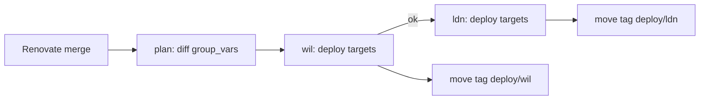

# GitOps Deploys

Renovate image bumps deploy themselves. When a Renovate merge to `main` changes
`ansible/environments/*/group_vars/`, the **Deploy** workflow joins the tailnet
from a GitHub-hosted runner and runs the affected playbooks — the same ones
`task ansible:deploy-*` runs — against that environment.



## How it works

| Piece | File |
|-------|------|
| Trigger, plan, per-environment fan-out | `.github/workflows/deploy.yml` |
| Tailscale, Ansible run, tag marker | `.github/workflows/deploy-env.yml` |
| Changed files → targets | `.github/scripts/deploy-plan.sh` |
| CI deploy user (tailnet-only key) | `ansible/roles/ci_deploy_user`, `ansible/playbooks/ci-access.yml` |
| Bootstrap tasks | `.taskfiles/ci/Taskfile.yaml` |

- **Trigger** — `push` to `main` touching `group_vars`, *and* the head commit is authored by `renovate[bot]`. Your own commits are never auto-deployed; use `task ansible:deploy-*` or **Run workflow**.
- **Plan** — diffs `group_vars` between the environment's tag `deploy/<env>` (last successful deploy) and the pushed commit. Because the base is the last *successful* deploy, a run that was cancelled, superseded or failed is picked up by the next one.
- **Targets** — only the allowlist below is ever auto-deployed. Anything else that changed is listed in the run summary as "deploy manually".
- **Order** — wil first, ldn only if wil didn't fail (no manual approval). One target at a time per environment; runs queue per environment.
- **Compose** — playbooks apply image bumps with `compose up` (`state: present`), which recreates only the services whose image or definition changed.
- **Note** — a playbook always deploys the whole current state of `main` for its stack. Anything you pushed but didn't deploy for that stack goes out too.

### Auto-deploy allowlist

| Changed under `group_vars/` | Runs |
|-----------------------------|------|
| `all/apps.yml` | `deploy-app.yml` for each app whose entry changed |
| `app_mediastack/` | `apps/media/deploy.yml` |
| `app_frigate/` | `apps/frigate/deploy.yml` |
| `app_gaming/` | `apps/gaming/deploy.yml` |
| `infra_monitoring/` | `infrastructure/monitoring/deploy.yml` |
| `infra_netboot/` | `infrastructure/netboot/deploy.yml` |

Never auto-deployed: `infra_ca`, `infra_networking`, `infra_ntp`, `infra_proxmox`, and `all/` other than `apps.yml`. CI has no SSH access to those hosts at all. To change the allowlist, edit `PLAYBOOK_FOR` in `deploy-plan.sh` **and** the host pattern in `playbooks/ci-access.yml` / `TARGET_PATTERN` in the CI Taskfile.

## Security model

- The runner joins as an **ephemeral `tag:ci` node** using workload identity federation — no long-lived Tailscale secret.
- The Tailscale policy grants `tag:ci` **TCP 22 to the deploy hosts only**. `ldn-gateway` also advertises the Haivision corporate /16s, so the grant must stay host-specific.
- CI logs in as **`deploy`**, whose key carries `from="<site gateway LAN IP>"`. The subnet router SNATs tailnet traffic, so the key only works when it arrives via the tailnet. `deploy` has passwordless sudo (every play uses `become`), so treat `SSH_DEPLOY_KEY` as root on the deploy hosts.
- Each environment has its own **CI age key**. `.sops.yaml` encrypts `ansible/environments/<env>/**/*.sops.yml` to master + that CI key only, so CI can't read Terraform/Packer credentials or the other environment's secrets.
- Secrets are **GitHub environment secrets** (`wil`, `ldn`), so they're only released to jobs running in that environment.
- **Logs** — the workflow never runs with `--diff` or `-v`; rendered templates contain decrypted secrets.

## One-time setup

Do wil first; ldn is the same with `ENV=ldn`.

### 1. Tailscale

Grants are additive and `"src": ["*"]` matches tagged devices, so the default allow-all has to be replaced, not added to. `autogroup:member` excludes tagged devices, and the subnet CIDRs keep site-to-site traffic working (`*` used to cover traffic *from* approved subnets: zone transfers, cross-site services, wil → Haivision via `ldn-gateway`). In the [policy file](https://tailscale.com/kb/1337/acl-syntax):

```json
"tagOwners": {
  "tag:ci": ["autogroup:admin"],
},

"hosts": {
  // CI deploy targets (keep in sync with ansible/playbooks/ci-access.yml)
  "wil-media":      "10.2.0.5",   // media stack + frigate
  "wil-monitoring": "10.2.20.30",
  "wil-web":        "10.2.20.45", // website, birdle
  "wil-gaming":     "10.2.20.50",
  "ldn-monitoring": "10.3.20.30",
  "ldn-work":       "10.3.20.50",
  "ldn-gaming":     "10.3.20.55",
  "ldn-netboot":    "10.3.20.60",
  "ldn-kosync":     "10.3.20.70",
  // used by tests only
  "wil-ns":      "10.2.20.53",
  "ldn-ns":      "10.3.20.53",
  "wil-ca":      "10.2.20.9",
  "ldn-pve":     "10.3.20.10",
  "corp-sample": "10.5.0.1",
},

"grants": [
  // Your devices: everything, as before.
  {"src": ["autogroup:member"], "dst": ["*"], "ip": ["*"]},
  // Site-to-site: hosts behind either subnet router.
  {"src": ["10.2.0.0/16", "10.3.0.0/16"], "dst": ["*"], "ip": ["*"]},
  // CI deploy runners: SSH to deploy targets only.
  {
    "src": ["tag:ci"],
    "dst": [
      "wil-media", "wil-monitoring", "wil-web", "wil-gaming",
      "ldn-monitoring", "ldn-work", "ldn-gaming", "ldn-netboot", "ldn-kosync",
    ],
    "ip": ["tcp:22"],
  },
],

"tests": [
  {
    "src": "tag:ci",
    "accept": ["wil-media:22", "ldn-work:22"],
    "deny": ["wil-media:32400", "wil-ns:22", "wil-ca:22", "ldn-pve:8006", "corp-sample:22"],
  },
  {"src": "sfcal@github", "accept": ["wil-ns:22", "ldn-pve:8006", "corp-sample:443"]},
  {"src": "wil-ns", "accept": ["ldn-ns:53"]},
  {"src": "ldn-ns", "accept": ["wil-ns:53"]},
],
```

Connections *initiated* from the Haivision ranges into the homelab are no longer allowed (replies to your own connections still are); add those /16s to the site-to-site `src` if anything there dials in.

Then create a [federated identity](https://tailscale.com/kb/1581/workload-identity-federation) for GitHub Actions with:

- subject `repo:sfcal/homelab:environment:wil` (one identity per environment)
- the writable `auth_keys` [scope](https://tailscale.com/kb/1623/trust-credentials#scopes), restricted to `tag:ci`

Note the client ID and audience. With [Tailnet Lock](https://tailscale.com/kb/1226/tailnet-lock) enabled, federation won't work: you'd need a pre-signed ephemeral auth key and the action's `statedir` instead.

### 2. Keys, deploy user, host keys

From your machine, on the LAN or tailnet:

```bash
task ci:keys ENV=wil               # CI SSH + age keys in ~/.config/homelab-ci/wil, re-encrypts wil secrets
task ansible:deploy-ci-access ENV=wil
task ci:known-hosts ENV=wil        # writes ansible/environments/wil/known_hosts
git add .sops.yaml ansible/environments/wil && git commit -m "ci deploy keys for wil"
```

### 3. GitHub

```bash
task ci:secrets ENV=wil            # creates the environment, sets SSH_DEPLOY_KEY + SOPS_AGE_KEY
gh secret set TS_OAUTH_CLIENT_ID --env wil
gh secret set TS_AUDIENCE --env wil
```

Optional variables (repo- or environment-level):

| Variable | Purpose |
|----------|---------|
| `DEPLOY_ENVS` | Environments Renovate merges auto-deploy to. Default `wil`; set `wil ldn` to enable prod |
| `TS_PING` | A tailnet peer (e.g. `wil-gateway`'s 100.x address) the action pings before deploying |
| `DEPLOY_NOTIFY_URL` | ntfy-style URL; receives a POST per target with the result |

### 4. Test

**Actions → Deploy → Run workflow**, env `wil`, target `playbook:infrastructure/monitoring/deploy.yml` (or `app:website`). Once that's green, Renovate merges deploy wil on their own.

### 5. Enable ldn

Repeat steps 2–3 with `ENV=ldn` (federated identity subject `repo:sfcal/homelab:environment:ldn`), test with `app:kosync`, then set `DEPLOY_ENVS` to `wil ldn`. ldn then deploys unattended once wil has succeeded — no approval step.

Images that only exist in ldn (kosync, the `work` apps, RomM, Wolf) have no wil canary; Renovate's `minimumReleaseAge` (1 day minor, 3 days major) is their buffer. If you ever want a pause before prod without having to approve anything, give the `ldn` environment a **wait timer** (free on public repos) — the run waits, and you can cancel it in that window.

## Day to day

- **Manual deploy** — Run workflow with `app:<name>` or `playbook:<path>`. With an empty target, it deploys everything changed since `deploy/<env>` and moves the tag.
- **Rollback** — `git revert` the Renovate commit. The revert is yours, not Renovate's, so deploy it with Run workflow (empty target) or `task ansible:deploy-*`.
- **Skipped changes** — the run summary lists files that changed but aren't auto-deployed.
- **`:latest` images** — Renovate opens no PRs for floating tags (`pinDigests: false`), so they never trigger a deploy. Pin a real tag to bring an image under GitOps.
