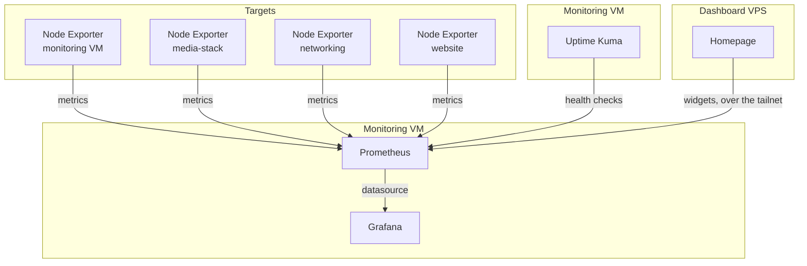

# Monitoring

The monitoring stack provides metrics collection, visualization, a service dashboard, and external uptime monitoring. It runs as Docker containers on a dedicated VM in each environment; Homepage, the service dashboard, runs once for both sites on an OVH VPS outside the lab (see [Homepage](#homepage)).

!!! note "Deployment order"
    Monitoring deploys after [Networking](../networking/index.md), [Step-CA](../ca/index.md), and [NTP](../ntp/index.md). It is the last infrastructure service to deploy before applications.

## Architecture



- **Prometheus** scrapes node exporters across all VMs for system metrics
- **Grafana** visualizes metrics from Prometheus with dashboards
- **Homepage** provides a service dashboard with status widgets and quick links
- **Uptime Kuma** provides uptime monitoring for internal services

## Components

| Component | Image | Port | Purpose |
|-----------|-------|------|---------|
| Prometheus | `prom/prometheus` | 9090 | Metrics collection and storage |
| Grafana | `grafana/grafana` | 3000 | Metrics visualization |
| Homepage | `ghcr.io/gethomepage/homepage` | 3002 (127.0.0.1 on the dashboard VPS) | Service dashboard |
| Uptime Kuma | `louislam/uptime-kuma` | 3001 | Uptime monitoring |

## Hosts

| Environment | VM | IP |
|-------------|----|----|
| WIL | Monitoring | `10.2.20.30` |
| LDN | Monitoring | `10.3.20.30` |
| External | VPS | `178.156.190.134` |
| Dashboard | OVH VPS (Homepage) | `135.148.219.216`, tailnet `dashboard` |

## File Locations

### Monitoring Stack

| File | Purpose |
|------|---------|
| `playbooks/infrastructure/monitoring/deploy.yml` | Main playbook |
| `playbooks/infrastructure/monitoring/tasks/monitoring-stack.yml` | Deployment task |
| `playbooks/infrastructure/monitoring/templates/compose.yaml.j2` | Docker Compose definition |
| `playbooks/infrastructure/monitoring/templates/prometheus.yml.j2` | Prometheus scrape config |
| `playbooks/infrastructure/monitoring/templates/grafana-datasources.yml.j2` | Grafana datasource provisioning |
| `playbooks/infrastructure/monitoring/handlers/main.yml` | Container lifecycle handlers |
| `inventory/group_vars/site_<env>/infra_monitoring/` | Per-environment variables |

### Dashboard (Homepage)

| File | Purpose |
|------|---------|
| `playbooks/infrastructure/dashboard/deploy.yml` | Playbook: Tailscale, Docker, Homepage |
| `playbooks/infrastructure/dashboard/tasks/homepage.yml` | Deployment task |
| `playbooks/infrastructure/dashboard/templates/compose.yaml.j2` | Docker Compose definition |
| `playbooks/infrastructure/dashboard/templates/homepage/services.yaml.j2` | Homepage services dashboard |
| `playbooks/infrastructure/dashboard/templates/homepage/bookmarks.yaml.j2` | Homepage bookmarks |
| `playbooks/infrastructure/dashboard/templates/homepage/settings.yaml.j2` | Homepage theme and layout |
| `playbooks/infrastructure/dashboard/templates/homepage/widgets.yaml.j2` | Homepage widgets |
| `inventory/group_vars/site_wil/infra_dashboard/vars.yml` | Image and allowed hosts |
| `inventory/group_vars/site_wil/secrets.sops.yml` | Widget API keys (section `infra_dashboard`) |

## Deployment

```bash
task ansible:deploy-monitoring ENV=wil
task ansible:deploy-dashboard ENV=wil    # Homepage on the OVH VPS (the VPS is in site_wil)
```

### Monitoring Stack Deployment

The task file:

1. Creates the directory structure: rendered config under `/opt/monitoring/`, Prometheus and Grafana state under `/var/lib/monitoring/`
2. Sets ownership to `monitoring_uid:monitoring_gid`
3. Deploys Prometheus configuration
4. Deploys Grafana datasource provisioning
5. Deploys Docker Compose file
6. Starts all containers and removes any that are no longer in `compose.yaml`

---

## Prometheus

Prometheus scrapes metrics from node exporters running on infrastructure and application VMs.

### Scrape Configuration

The `prometheus.yml.j2` template generates the scrape config:

```yaml
global:
  scrape_interval: 15s
  evaluation_interval: 15s

scrape_configs:
  - job_name: 'prometheus'
    static_configs:
      - targets: ['localhost:9090']

  - job_name: 'node-exporter'
    static_configs:
      - targets:
          - 'localhost:9100'
          - '10.2.0.5:9100'
          # ... all node targets
```

Three additional jobs — `chrony`, `gpsd`, and `node` — scrape the PTP grandmaster's exporters (deployed by the `ptp-experiments` repo's `monitoring` role). Each renders only when its per-environment target list is non-empty; currently only LDN defines them. The `node` job is kept separate from `node-exporter` because the Chrony dashboard's CPU-temperature panel selects `job="node"` unscoped.

### Container Configuration

- **Memory:** 2GB limit, 1GB reservation
- **Retention:** configurable via `prometheus_retention`
- **Storage:** persistent volume at `/prometheus`
- **User:** runs as `monitoring_uid:monitoring_gid`

<small>**Source:** [`ansible/playbooks/infrastructure/monitoring/templates/prometheus.yml.j2`](https://github.com/sfcal/homelab/blob/main/ansible/playbooks/infrastructure/monitoring/templates/prometheus.yml.j2)</small>

### Configuration Reference

| Parameter | Type | Description | Default |
|-----------|------|-------------|---------|
| `prometheus_image` | `string` | Docker image for Prometheus | (per-env) |
| `prometheus_retention` | `string` | Metrics data retention period | `"30d"` |
| `prometheus_node_targets` | `list[string]` | Node exporter endpoints to scrape (`host:port`) | (per-env) |
| `prometheus_chrony_targets` | `list[string]` | chrony_exporter endpoints (PTP grandmaster, `:9123`) | `[]` |
| `prometheus_gpsd_targets` | `list[string]` | gpsd exporter endpoints (PTP grandmaster, `:9015`) | `[]` |
| `prometheus_ptp_node_targets` | `list[string]` | PTP grandmaster node_exporter endpoints (job `node`, `:9100`) | `[]` |
| `node_exporter_image` | `string` | Docker image for Node Exporter sidecar | (per-env) |

<small>**Sources:** `ansible/inventory/group_vars/site_<env>/infra_monitoring/prometheus.yml` · `ansible/inventory/group_vars/site_<env>/infra_monitoring/containers.yml`</small>

---

## Grafana

Grafana connects to Prometheus as its default datasource and provides metric visualization dashboards.

### Datasource Provisioning

Grafana auto-provisions a Prometheus datasource on startup via `grafana-datasources.yml.j2`:

```yaml
apiVersion: 1
datasources:
  - name: Prometheus
    uid: prometheus
    type: prometheus
    access: proxy
    url: http://prometheus:9090
    isDefault: true
    editable: true
```

The datasource carries the fixed uid `prometheus` because the provisioned dashboards bind to it.

### Dashboard Provisioning

Dashboards are provisioned from files — any JSON dropped into `playbooks/infrastructure/monitoring/files/dashboards/` is deployed and picked up automatically (the file provider rescans every 30 s; UI edits to provisioned dashboards do not persist):

| Dashboard | File | Data |
|-----------|------|------|
| Chrony Detail | `chrony_grafana_dashboard.json` | `chrony` + `node` jobs (PTP grandmaster) |
| GPSD | `gpsd_grafana_dashboard.json` | `gpsd` job (PTP grandmaster) |
| Node Exporter Full | `node_exporter_full.json` | All `node-exporter`/`node` targets ([grafana.com 1860](https://grafana.com/grafana/dashboards/1860)) |
| System Activity | `system_activity.json` | CPU, memory, network and disk I/O per `node-exporter` target; Homepage embeds its four panels |

### Container Configuration

- **Memory:** 2GB limit, 1GB reservation
- **Depends on:** Prometheus
- **Provisioning:** mounted read-only at `/etc/grafana/provisioning`
- **Sign-up:** disabled (`GF_USERS_ALLOW_SIGN_UP=false`)
- **Embedding:** allowed, and anyone who is not signed in gets read-only access (`GF_SECURITY_ALLOW_EMBEDDING`, `GF_AUTH_ANONYMOUS_*`), so Homepage can show panels in iframes without a Grafana login

### Configuration Reference

| Parameter | Type | Description | Default |
|-----------|------|-------------|---------|
| `grafana_image` | `string` | Docker image for Grafana | (per-env) |
| `grafana_admin_user` | `string` | Admin username for the web UI | `"admin"` |
| `grafana_admin_password` | `string` | Admin password (SOPS-encrypted) | (required) |
| `grafana_url` | `string` | Root URL for links in notifications and dashboards | (per-env) |

<small>**Sources:** `ansible/inventory/group_vars/site_<env>/infra_monitoring/grafana.yml` · [`ansible/playbooks/infrastructure/monitoring/templates/grafana-datasources.yml.j2`](https://github.com/sfcal/homelab/blob/main/ansible/playbooks/infrastructure/monitoring/templates/grafana-datasources.yml.j2)</small>

---

## Homepage

Homepage provides a service dashboard with status widgets, service health indicators, and quick links to all homelab services. One instance covers both sites and runs on an OVH VPS (`135.148.219.216`, Virginia), so it stays up when a site is down; its cards then show what is unreachable.

### Access

Tailnet only: **http://dashboard/** (needs Tailscale's DNS on the device, which adds the tailnet's search domain). Homepage listens on `127.0.0.1:3002`, and `tailscale serve` puts it on the tailnet's port 80. The VPS has no other open port besides SSH. Plain HTTP, because the System Activity panels load from each monitoring VM's Grafana by IP over HTTP and an HTTPS page would block them; the tailnet encrypts the traffic anyway. Use the short name: for the full name `dashboard.tail1e494e.ts.net`, Chrome tries HTTPS first and warns or blocks, since the tailnet has HTTPS certificates off (single-label names are exempt).

`tailscale serve` cannot proxy to the sites' subnets itself (tailscaled's own connections don't use the subnet routes), so anything the browser needs from a site must be reachable from the browser directly, like the Grafana panels.

The VPS joins the tailnet as a client named `dashboard` that accepts the sites' subnet routes, which is how its widgets reach `10.2.x.x` and `10.3.x.x`. Its Tailscale values are set in `dashboard/deploy.yml`, not in group vars, because every wil host also inherits `site_wil/infra_networking/tailscale.yml` (wil-gateway's subnet router).

### Container Configuration

- **Memory:** 512MB limit, 256MB reservation
- **Ports:** `127.0.0.1:3002` only
- **Environment:** receives API keys for service widgets (Sonarr, Radarr, Bazarr, Prowlarr, SABnzbd, Plex); `compose.yaml` is root-only (`0600`)

### Configuration Reference

| Parameter | Type | Description | Default |
|-----------|------|-------------|---------|
| `homepage_image` | `string` | Docker image for Homepage | `ghcr.io/gethomepage/homepage:latest` |
| `homepage_allowed_hosts` | `string` | Comma-separated hostnames Homepage responds to | `dashboard.tail1e494e.ts.net,dashboard` |

### Dashboard Configuration

Homepage is configured via four YAML template files:

| Template | Purpose |
|----------|---------|
| `services.yaml.j2` | Service cards with status widgets (Grafana graphs, media, apps, infrastructure, monitoring, node exporters) |
| `bookmarks.yaml.j2` | Quick links (TrueNAS, Proxmox) |
| `settings.yaml.j2` | Theme (dark, slate), layout (row style, column counts) |
| `widgets.yaml.j2` | Global widgets (search bar, datetime) |

`services.yaml.j2` is plain Homepage YAML; edit it directly. Four parts are less obvious:

- **Per-site groups:** System Activity, Apps, Infrastructure, Monitoring and Node Exporters appear once per site, named `(wil)` and `(ldn)`. A new group needs a matching entry in the `layout` of `settings.yaml.j2`.
- **System Activity** shows the four panels of each site's System Activity Grafana dashboard in iframes from `http://10.<site>.20.30:3000/d-solo/system-activity?panelId=1` to `4`. They use the IP because `grafana.<site>.5am.cloud` is behind Authelia, and a browser does not send that login cookie to a frame inside a page on another domain. Grafana allows anonymous viewing and embedding. The time range and refresh interval come from the dashboard JSON.
- **Node Exporters** lists the targets of each site's `prometheus_node_targets` by hand; add a node there too.
- **SABnzbd** has two widgets: Homepage's `sabnzbd` widget (speed, queue) and a `customapi` widget that reads the download totals for today, this week, this month and all time from SABnzbd's `server_stats` API once a minute.

<small>**Sources:** `ansible/inventory/group_vars/site_wil/infra_dashboard/vars.yml` · [`ansible/playbooks/infrastructure/dashboard/templates/homepage/services.yaml.j2`](https://github.com/sfcal/homelab/blob/main/ansible/playbooks/infrastructure/dashboard/templates/homepage/services.yaml.j2)</small>

---

## Shared Configuration

These variables apply to all monitoring containers:

| Parameter | Type | Description | Default |
|-----------|------|-------------|---------|
| `monitoring_uid` | `string` | Container file ownership UID | `"1000"` |
| `monitoring_gid` | `string` | Container file ownership GID | `"1000"` |
| `backup_targets` | `list[string]` | Service directories under `/var/lib/monitoring/` to back up | (per-env) |

## Common Tasks

### Add a new Prometheus scrape target

1. Edit `ansible/inventory/group_vars/site_<env>/infra_monitoring/prometheus.yml`:

    ```yaml
    prometheus_node_targets:
      # ... existing targets
      - "10.2.20.60:9100"   # new VM
    ```

2. Deploy:

    ```bash
    task ansible:deploy-monitoring ENV=wil
    ```

### Change metrics retention

1. Edit `ansible/inventory/group_vars/site_<env>/infra_monitoring/prometheus.yml`:

    ```yaml
    prometheus_retention: "90d"
    ```

2. Deploy:

    ```bash
    task ansible:deploy-monitoring ENV=wil
    ```

### Add a Homepage service widget

1. Edit `ansible/playbooks/infrastructure/dashboard/templates/homepage/services.yaml.j2`
2. Add a new service entry under the appropriate section
3. If the service requires an API key, add the key to the `infra_dashboard` section of `group_vars/site_wil/secrets.sops.yml` and pass it through `dashboard/templates/compose.yaml.j2`
4. Deploy:

    ```bash
    task ansible:deploy-dashboard ENV=wil
    ```
