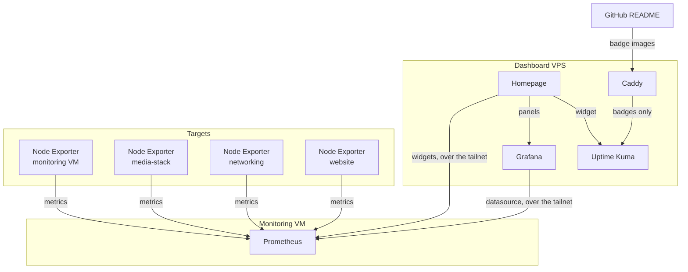

# Monitoring

The monitoring stack provides metrics collection, visualization, a service dashboard, and external uptime monitoring. Prometheus runs as a Docker container on a dedicated VM in each environment; Grafana, Homepage and Uptime Kuma run once for both sites on an OVH VPS outside the lab (see [Grafana](#grafana) and [Homepage](#homepage)).

!!! note "Deployment order"
    Monitoring deploys after [Networking](../networking/index.md), [Step-CA](../ca/index.md), and [NTP](../ntp/index.md). It is the last infrastructure service to deploy before applications.

## Architecture



- **Prometheus** scrapes node exporters across all VMs for system metrics
- **Grafana** visualizes metrics from both sites' Prometheus with dashboards
- **Homepage** provides a service dashboard with status widgets and quick links
- **Uptime Kuma** checks services from outside the lab and serves the README's status badges

## Components

| Component | Image | Port | Purpose |
|-----------|-------|------|---------|
| Prometheus | `prom/prometheus` | 9090 | Metrics collection and storage |
| Grafana | `grafana/grafana` | 3000 (127.0.0.1 on the dashboard VPS) | Metrics visualization |
| Homepage | `ghcr.io/gethomepage/homepage` | 3002 (127.0.0.1 on the dashboard VPS) | Service dashboard |
| Uptime Kuma | `louislam/uptime-kuma` | 3001 (127.0.0.1 on the dashboard VPS) | Uptime checks, README badges |
| Caddy | `caddy` | 80, 443 (public, on the dashboard VPS) | Uptime Kuma's badges only |

## Hosts

| Environment | VM | IP |
|-------------|----|----|
| WIL | Monitoring | `10.2.20.30` |
| LDN | Monitoring | `10.3.20.30` |
| External | VPS | `178.156.190.134` |
| Dashboard | OVH VPS (Grafana, Homepage, Uptime Kuma) | `135.148.219.216`, tailnet `dashboard` |

## File Locations

### Monitoring Stack

| File | Purpose |
|------|---------|
| `playbooks/infrastructure/monitoring/deploy.yml` | Main playbook |
| `playbooks/infrastructure/monitoring/tasks/monitoring-stack.yml` | Deployment task |
| `playbooks/infrastructure/monitoring/templates/compose.yaml.j2` | Docker Compose definition |
| `playbooks/infrastructure/monitoring/templates/prometheus.yml.j2` | Prometheus scrape config |
| `playbooks/infrastructure/monitoring/handlers/main.yml` | Container lifecycle handlers |
| `inventory/group_vars/site_<env>/infra_monitoring/` | Per-environment variables |

### Dashboard VPS (Grafana, Homepage, Uptime Kuma)

| File | Purpose |
|------|---------|
| `playbooks/infrastructure/dashboard/deploy.yml` | Playbook: Tailscale, Docker, Uptime Kuma, Grafana, Homepage |
| `playbooks/infrastructure/dashboard/tasks/uptime-kuma.yml` | Uptime Kuma and Caddy directories, Caddyfile, tailnet port 3001 |
| `playbooks/infrastructure/dashboard/tasks/grafana.yml` | Grafana directories, provisioning and dashboards, tailnet port 3000 |
| `playbooks/infrastructure/dashboard/tasks/homepage.yml` | Homepage config, starts the compose project |
| `playbooks/infrastructure/dashboard/templates/compose.yaml.j2` | Docker Compose definition (Homepage, Uptime Kuma, Grafana, Caddy) |
| `playbooks/infrastructure/dashboard/files/grafana/provisioning/` | Grafana datasources (each site's Prometheus) and dashboard provider |
| `playbooks/infrastructure/dashboard/files/grafana/dashboards/` | Grafana dashboards (JSON) |
| `playbooks/infrastructure/dashboard/files/Caddyfile` | Public site: Uptime Kuma's badges only |
| `playbooks/infrastructure/dashboard/templates/homepage/services.yaml.j2` | Homepage service cards, for all four tabs |
| `playbooks/infrastructure/dashboard/templates/homepage/bookmarks.yaml.j2` | Homepage bookmarks (none) |
| `playbooks/infrastructure/dashboard/templates/homepage/settings.yaml.j2` | Homepage theme, tabs and layout |
| `playbooks/infrastructure/dashboard/templates/homepage/widgets.yaml.j2` | Homepage widgets |
| `playbooks/infrastructure/dashboard/files/homepage/custom.css` | Homepage colours, type and card styles |
| `inventory/group_vars/site_ovh/infra_dashboard/vars.yml` | Images, allowed hosts, Grafana admin user and URL |
| `inventory/group_vars/site_wil/proxy/ext.5am.cloud.yml` | wil's BIND record for `uptime.ext.5am.cloud` |
| `inventory/group_vars/site_ovh/infra_dashboard/tailscale.yml` | Tailscale client settings |
| `inventory/group_vars/site_ovh/secrets.sops.yml` | Widget API keys and Grafana admin password (section `infra_dashboard`) |

## Deployment

```bash
task ansible:deploy-monitoring ENV=wil
task ansible:deploy-dashboard ENV=ovh    # Grafana, Homepage, Uptime Kuma and Kanidm on the OVH VPS (site ovh)
```

### Monitoring Stack Deployment

The task file:

1. Creates the directory structure: rendered config under `/opt/monitoring/`, Prometheus state under `/var/lib/monitoring/`
2. Sets ownership to `monitoring_uid:monitoring_gid`
3. Deploys Prometheus configuration
4. Deploys Docker Compose file
5. Starts all containers and removes any that are no longer in `compose.yaml`

---

## Prometheus

Prometheus scrapes metrics from node exporters running on infrastructure and application VMs.

### Scrape Configuration

The `prometheus.yml.j2` template generates the scrape config:

```yaml
global:
  scrape_interval: 15s
  evaluation_interval: 15s

scrape_configs:
  - job_name: 'prometheus'
    static_configs:
      - targets: ['localhost:9090']

  - job_name: 'node-exporter'
    static_configs:
      - targets:
          - 'localhost:9100'
          - '10.2.0.5:9100'
          # ... all node targets
```

Three additional jobs — `chrony`, `gpsd`, and `node` — scrape the PTP grandmaster's exporters (deployed by the `ptp-experiments` repo's `monitoring` role). Each renders only when its per-environment target list is non-empty; currently only LDN defines them. The `node` job is kept separate from `node-exporter` because the Chrony dashboard's CPU-temperature panel selects `job="node"` unscoped.

### Container Configuration

- **Memory:** 2GB limit, 1GB reservation
- **Retention:** configurable via `prometheus_retention`
- **Storage:** persistent volume at `/prometheus`
- **User:** runs as `monitoring_uid:monitoring_gid`

<small>**Source:** [`ansible/playbooks/infrastructure/monitoring/templates/prometheus.yml.j2`](https://github.com/sfcal/homelab/blob/main/ansible/playbooks/infrastructure/monitoring/templates/prometheus.yml.j2)</small>

### Configuration Reference

| Parameter | Type | Description | Default |
|-----------|------|-------------|---------|
| `prometheus_image` | `string` | Docker image for Prometheus | (per-env) |
| `prometheus_retention` | `string` | Metrics data retention period | `"30d"` |
| `prometheus_node_targets` | `list[string]` | Node exporter endpoints to scrape (`host:port`) | (per-env) |
| `prometheus_chrony_targets` | `list[string]` | chrony_exporter endpoints (PTP grandmaster, `:9123`) | `[]` |
| `prometheus_gpsd_targets` | `list[string]` | gpsd exporter endpoints (PTP grandmaster, `:9015`) | `[]` |
| `prometheus_ptp_node_targets` | `list[string]` | PTP grandmaster node_exporter endpoints (job `node`, `:9100`) | `[]` |
| `node_exporter_image` | `string` | Docker image for Node Exporter sidecar | (per-env) |

<small>**Sources:** `ansible/inventory/group_vars/site_<env>/infra_monitoring/prometheus.yml` · `ansible/inventory/group_vars/site_<env>/infra_monitoring/containers.yml`</small>

---

## Grafana

One Grafana covers both sites. It runs on the OVH VPS next to Homepage, in the same compose project (`/opt/dashboard`, state in `/var/lib/dashboard/grafana`), and reads each site's Prometheus over the tailnet, so it stays up when a site is down; that site's graphs are then empty.

### Access

Tailnet only: **http://dashboard:3000**. Grafana listens on `127.0.0.1:3000`, and `tailscale serve` puts it on the tailnet's port 3000. Anyone on the tailnet can view the dashboards without signing in; sign in as `admin` to edit. There is no `grafana.<site>.5am.cloud` name any more.

### Datasource Provisioning

`files/grafana/provisioning/datasources/datasources.yml` provisions one Prometheus datasource per site:

| Name | uid | URL |
|------|-----|-----|
| Prometheus (wil) | `prometheus-wil` (default) | `http://10.2.20.30:9090` |
| Prometheus (ldn) | `prometheus-ldn` | `http://10.3.20.30:9090` |

The uids are fixed because the provisioned dashboards bind to them. Grafana reads datasources at start; the playbook restarts it when the file changes.

### Dashboard Provisioning

Dashboards are provisioned from files — any JSON dropped into `playbooks/infrastructure/dashboard/files/grafana/dashboards/` is deployed and picked up automatically (the file provider rescans every 30 s; UI edits to provisioned dashboards do not persist):

| Dashboard | File | Data |
|-----------|------|------|
| Chrony Detail | `chrony_grafana_dashboard.json` | `chrony` + `node` jobs (PTP grandmaster), from `prometheus-ldn` |
| GPSD | `gpsd_grafana_dashboard.json` | `gpsd` job (PTP grandmaster), from `prometheus-ldn` |
| Node Exporter Full | `node_exporter_full.json` | All `node-exporter`/`node` targets, site picked with the Datasource variable ([grafana.com 1860](https://grafana.com/grafana/dashboards/1860)) |
| System Activity | `system_activity.json` | CPU, memory, network and disk I/O per `node-exporter` target, site picked with the Site variable (`?var-ds=prometheus-wil` or `prometheus-ldn`); Homepage embeds its four panels |

A new dashboard either binds to one site's uid or gets a datasource variable (type `datasource`, query `prometheus`) and uses `${<variable>}` as each panel's datasource uid.

### Container Configuration

- **Memory:** 1GB limit, 256MB reservation
- **Ports:** `127.0.0.1:3000` only
- **Provisioning:** mounted read-only at `/etc/grafana/provisioning`
- **Sign-up:** disabled (`GF_USERS_ALLOW_SIGN_UP=false`)
- **Embedding:** allowed, and anyone who is not signed in gets read-only access (`GF_SECURITY_ALLOW_EMBEDDING`, `GF_AUTH_ANONYMOUS_*`), so Homepage can show panels in iframes without a Grafana login

### Configuration Reference

| Parameter | Type | Description | Default |
|-----------|------|-------------|---------|
| `grafana_image` | `string` | Docker image for Grafana | `grafana/grafana:13.3.0` |
| `grafana_admin_user` | `string` | Admin username for the web UI | `"admin"` |
| `grafana_admin_password` | `string` | Admin password (SOPS-encrypted, `site_ovh/secrets.sops.yml`); only applied when Grafana creates its database | (required) |
| `grafana_url` | `string` | Root URL for links in notifications and dashboards | `http://dashboard:3000` |

<small>**Sources:** `ansible/inventory/group_vars/site_ovh/infra_dashboard/vars.yml` · [`ansible/playbooks/infrastructure/dashboard/files/grafana/provisioning/datasources/datasources.yml`](https://github.com/sfcal/homelab/blob/main/ansible/playbooks/infrastructure/dashboard/files/grafana/provisioning/datasources/datasources.yml)</small>

---

## Homepage

Homepage provides a service dashboard with status widgets, service health indicators, and quick links to all homelab services. One instance covers both sites and runs on an OVH VPS (`135.148.219.216`, Virginia), so it stays up when a site is down; its cards then show what is unreachable.

### Access

Tailnet only: **http://dashboard/** (needs Tailscale's DNS on the device, which adds the tailnet's search domain). Homepage listens on `127.0.0.1:3002`, and `tailscale serve` puts it on the tailnet's port 80. Besides SSH, the VPS's only public ports are 80 and 443, which serve Uptime Kuma's badges and nothing else (see [Uptime Kuma](#uptime-kuma)). Plain HTTP, because the System Activity panels load from Grafana at `http://dashboard:3000` and an HTTPS page would block them; the tailnet encrypts the traffic anyway. Use the short name: for the full name `dashboard.tail1e494e.ts.net`, Chrome tries HTTPS first and warns or blocks, since the tailnet has HTTPS certificates off (single-label names are exempt).

`tailscale serve` cannot proxy to the sites' subnets itself (tailscaled's own connections don't use the subnet routes), so anything the browser needs from a site must be reachable from the browser directly. Grafana's panels don't need that: Grafana runs on the VPS and queries the sites from its container, which does use the routes.

The VPS joins the tailnet as a client named `dashboard` that accepts the sites' subnet routes, which is how its widgets reach `10.2.x.x` and `10.3.x.x`. Its Tailscale values are in `site_ovh/infra_dashboard/tailscale.yml`. The VPS is its own site, `ovh`, so it inherits nothing from the lab sites (in `site_wil` it would pick up wil-gateway's subnet-router settings).

### Container Configuration

- **Memory:** 512MB limit, 256MB reservation
- **Ports:** `127.0.0.1:3002` only
- **Environment:** receives API keys for service widgets (Sonarr, Radarr, Bazarr, Prowlarr, SABnzbd, Plex); `compose.yaml` is root-only (`0600`)

### Configuration Reference

| Parameter | Type | Description | Default |
|-----------|------|-------------|---------|
| `homepage_image` | `string` | Docker image for Homepage | `ghcr.io/gethomepage/homepage:latest` |
| `homepage_allowed_hosts` | `string` | Comma-separated hostnames Homepage responds to | `dashboard.tail1e494e.ts.net,dashboard` |

### Dashboard Configuration

Homepage is configured via four YAML template files and a stylesheet:

| File | Purpose |
|----------|---------|
| `services.yaml.j2` | Service cards: a small card per service for the Overview tab, and the full cards with widgets for the site tabs (Grafana graphs, media, apps, infrastructure, monitoring) |
| `bookmarks.yaml.j2` | Empty: every link is a card on the Overview tab. The file stays, because Homepage writes its example bookmarks when it is missing |
| `settings.yaml.j2` | Theme (light, gray), status dots, tabs (Overview, wil, ldn, ovh), group icons, layout (row style, column counts) |
| `widgets.yaml.j2` | Global widgets (the VPS's resources, search bar, datetime) |
| `files/homepage/custom.css` | The look: the layout of a dashboard shared in [Homepage's "Share your homepage" thread](https://github.com/gethomepage/homepage/discussions/473#discussioncomment-18831380) in the colours of [samuel.computer](https://samuel.computer) (sky page, frosted-glass header, white cards, olive accents, Inter) |

The dashboard has four tabs:

| Tab | Shows |
|-----|-------|
| Overview | Every service of all three sites as a small card (icon, link, status dot), in the groups Media, Apps, Infrastructure and Monitoring. Opens first |
| wil | wil in full: System Activity graphs, the media stack's cards with their widgets, apps, infrastructure, Prometheus and the node exporters |
| ldn | The same for ldn |
| ovh | The VPS's own services: Grafana, Uptime Kuma, Kanidm |

`services.yaml.j2` is plain Homepage YAML; edit it directly. These parts are less obvious:

- **Two cards per service:** Homepage shows a group on one tab only, so each service is written twice: a small card (`icon`, `href`, `siteMonitor`) in an Overview group, and its full card (with `description` and widgets) in its site's group. Change a link or a status URL in both.
- **Links:** a small card's `href` ends in `/` and its full card's doesn't. Quick launch (start typing on the page) lists both cards, and two entries with the same name and the same link make it show results that no longer match what was typed.
- **Group names** are unique across the file, because Homepage finds a card by its group's name. That is why most groups on the site tabs carry their site: `Apps (wil)`, `Apps (ldn)`, `Services (ovh)`. A new group needs a matching entry in the `layout` of `settings.yaml.j2`, with the `tab` it belongs on; a group left out of `layout` shows on every tab.
- **Status dots:** `siteMonitor` requests the URL from the VPS and counts any answer up to 403 as up. KOSync's small card has none: it answers 412 to a request without KOReader's `Accept` header, so only its full card checks it, with a `customapi` widget that sends the header.
- **Tile colours:** a widget's `highlight` rules mark tiles good, warn or danger, and `custom.css` tints them lime, orange or pink (Homepage's own tints lose to the tile background). Used for Prometheus targets down, Uptime Kuma sites down, Tdarr errors, Prowlarr failed grabs and KOSync health.
- **System Activity** shows the four panels of the System Activity Grafana dashboard on each site's tab, in iframes from `http://dashboard:3000/d-solo/system-activity?var-ds=prometheus-<site>&panelId=1` to `4`, in Grafana's light theme (`theme=light`). `var-ds` picks the site's Prometheus. Grafana allows anonymous viewing and embedding. The time range and refresh interval come from the dashboard JSON.
- **Node exporters** follow Prometheus in each site's Monitoring group: the targets of the site's `prometheus_node_targets`, listed by hand; add a node there too.
- **Five cards in a row** (`columns: 5`: the Overview groups and the Monitoring groups) become four in a window 1024px to 1279px wide, where five are too narrow (`custom.css`). Narrower windows get Homepage's own two in a row, then one.
- **SABnzbd** has two widgets: Homepage's `sabnzbd` widget (speed, queue) and a `customapi` widget that reads the download totals for today, this week, this month and all time from SABnzbd's `server_stats` API once a minute.

<small>**Sources:** `ansible/inventory/group_vars/site_ovh/infra_dashboard/vars.yml` · [`ansible/playbooks/infrastructure/dashboard/templates/homepage/services.yaml.j2`](https://github.com/sfcal/homelab/blob/main/ansible/playbooks/infrastructure/dashboard/templates/homepage/services.yaml.j2)</small>

---

## Uptime Kuma

Uptime Kuma runs next to Homepage on the OVH VPS, in the same compose project (`/opt/dashboard`, state in `/var/lib/dashboard/uptime-kuma`), so its checks keep running when a site is down. It reaches the sites over the tailnet like Homepage's widgets, and the internet directly. The status badges in the repository's README come from it.

### Access

- **Admin page:** tailnet only, **http://dashboard:3001**. Uptime Kuma listens on `127.0.0.1:3001` and `tailscale serve` puts it on the tailnet's port 3001. The first visit asks for the admin account. `UPTIME_KUMA_DB_TYPE=sqlite` skips the database question that Uptime Kuma 2 asks first.
- **Badges:** public, **https://uptime.ext.5am.cloud/api/badge/...**. Caddy (`files/Caddyfile`) passes `/api/badge/*` to Uptime Kuma and answers 404 for everything else, the login and status pages included. It gets its certificate from Let's Encrypt, so ports 80 and 443 are open on the VPS's public address (only there: `tailscale serve` holds port 80 on the tailnet address).
- **DNS:** `uptime.ext.5am.cloud` is a DNS-only A record in Cloudflare pointing at `135.148.219.216`, and wil's BIND serves the same address to the lab (`site_wil/proxy/ext.5am.cloud.yml`, applied by a wil networking deploy).

Monitors and status pages live in Uptime Kuma's database, not in Ansible: add them on the admin page.

### Badges

Uptime Kuma only draws a badge for a monitor that is on a published status page; any other monitor ID returns a grey `N/A`. Every monitor with a badge goes on the status page with the slug `default`, which Homepage's Uptime Kuma widget reads too. The page itself isn't reachable from the internet; publishing it only lets the badges show.

| Badge | URL |
|-------|-----|
| Up / Down | `https://uptime.ext.5am.cloud/api/badge/<id>/status?label=<name>` |
| Uptime % | `https://uptime.ext.5am.cloud/api/badge/<id>/uptime/<duration>?label=<name>` (`24h`, `7d`, `30d`; set `label`, the default one reads `Uptime (30h)` for `30d`) |
| Response time | `https://uptime.ext.5am.cloud/api/badge/<id>/ping/<duration>` |
| Certificate expiry | `https://uptime.ext.5am.cloud/api/badge/<id>/cert-exp` |

The monitor ID is the number at the end of its URL on the admin page (`/dashboard/<id>`). Badges are sent with `Cache-Control: no-store`, so GitHub's image proxy shows the current state (Uptime Kuma caches each badge for 5 minutes itself).

### Configuration Reference

| Parameter | Type | Description | Default |
|-----------|------|-------------|---------|
| `uptime_kuma_image` | `string` | Docker image for Uptime Kuma | `louislam/uptime-kuma:2.5.9` |

The badge proxy is Caddy built from `networking/templates/Dockerfile.j2` (the sites' build, with the Cloudflare DNS plugin that Kanidm's `auth.5am.cloud` certificate needs), and its version is pinned there.

<small>**Sources:** `ansible/inventory/group_vars/site_ovh/infra_dashboard/vars.yml` · [`ansible/playbooks/infrastructure/dashboard/files/Caddyfile`](https://github.com/sfcal/homelab/blob/main/ansible/playbooks/infrastructure/dashboard/files/Caddyfile)</small>

---

## Shared Configuration

These variables apply to all monitoring containers:

| Parameter | Type | Description | Default |
|-----------|------|-------------|---------|
| `monitoring_uid` | `string` | Container file ownership UID | `"1000"` |
| `monitoring_gid` | `string` | Container file ownership GID | `"1000"` |
| `backup_targets` | `list[string]` | Service directories under `/var/lib/monitoring/` to back up | (per-env) |

## Common Tasks

### Add a new Prometheus scrape target

1. Edit `ansible/inventory/group_vars/site_<env>/infra_monitoring/prometheus.yml`:

    ```yaml
    prometheus_node_targets:
      # ... existing targets
      - "10.2.20.60:9100"   # new VM
    ```

2. Deploy:

    ```bash
    task ansible:deploy-monitoring ENV=wil
    ```

### Change metrics retention

1. Edit `ansible/inventory/group_vars/site_<env>/infra_monitoring/prometheus.yml`:

    ```yaml
    prometheus_retention: "90d"
    ```

2. Deploy:

    ```bash
    task ansible:deploy-monitoring ENV=wil
    ```

### Add a service to Homepage

1. Edit `ansible/playbooks/infrastructure/dashboard/templates/homepage/services.yaml.j2`
2. Add the service twice: its full card (description, widget) to a group of its site, and a small card (`icon`, `href` ending in `/`, `siteMonitor`) to the matching Overview group
3. If the service requires an API key, add the key to the `infra_dashboard` section of `group_vars/site_ovh/secrets.sops.yml` and pass it through `dashboard/templates/compose.yaml.j2`
4. Deploy:

    ```bash
    task ansible:deploy-dashboard ENV=ovh
    ```

### Add a README badge

1. On http://dashboard:3001, add the monitor and put it on the `default` status page (Edit Status Page → add the monitor → Save)
2. Note its ID from the address bar (`/dashboard/<id>`)
3. Add the badge to `README.md`:

    ```markdown
    
    ```

No deploy needed: monitors live in Uptime Kuma's database.
